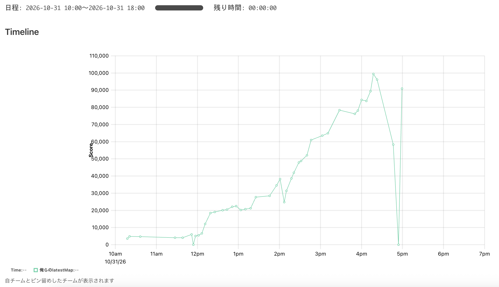

ISUCON2026 にチーム「俺らの latestMap」として出場し、最終スコア 106,371 で 154 位でした [^final-score]。

[^final-score]: <https://isucon.net/archives/60126600.html> 本番に参加したチームは約 600 チーム

[初参加の ISUCON13 では 60 位](/posts/isucon13)、そして [ISUCON14 では 54 位](/posts/isucon14) と来ていたので今年は 30 位以内に入りたかったのですが、ずっこけました。
普通に準備と実力が足りておらず、悔しいというより呆然としています。

それでも ISUCON はブログを書くまでが ISUCON ということで、振り返りを書きます。

## 準備したこと

最初に考えた方針は、AI が分析し、人間が次の一手を決めるというものでした。

ベンチマークハック的な改善や大胆な構成変更などは AI には難しく、序盤から AI に任せきりだと終盤のスコアの伸びが悪くなるだろう、という予測のもと、チューニングの流れを人間が終始握り続けるのが大事なんだと考えていました。

フローとしては以下のような形で、1 ヶ月ほどチーム練習をやっていました。

1. 人間はこれまで作ってきた監視・計測ツールを使って観察しながら、AI 向けの計測結果をテキストファイルに出力するようにし、AI にボトルネックを分析してもらう
2. 分析レポートを人間が読み、次の一手を決めて AI にコーディングしてもらう

ところが「完全自律 AI が数百万点を出しました」という記事やツイートが度々流れてくるようになり、今のやり方では周囲に全く追いつけないと気づき、自分たちも AI にチューニングのループを回してもらう方針に切り替えることにしました。

そう決めたのが本番の約 1 ヶ月前の 9 月末のことでした。

それから AI に全自動で動いてもらうためのツール作成や CLAUDE.md / skills 作りを進め、最低限回せる状態にしました。

- CLAUDE.md: マニュアルファイルの場所や、大原則として計測に基づいて改善すること、改善のログを残すこと、エラーは最優先で潰すこと、メトリクスとアプリケーション仕様の両方を見ること、そして DB 負荷の改善策などをそれぞれ数行程度で書く
- skills: 改善ループの回し方と、ベンチマークのトリガー方法を教える

そしてようやく本番前最後の週に ISUCON13 で 3 時間 27 万点を取れるくらいになりました。
決して高くないスコアではありますが、練習でスコアを出しすぎても過去問への最適化でしかないだろうという考えで、良しとしていました。

ハーネスをガチガチに固めすぎず、AI には自由な発想でスコアを伸ばしてもらいたいという気持ちで準備をしてきました。

## 競技中の取り組み

今回の問題は BeReal をモチーフにした画像投稿アプリで、asia (asia1 / asia2), europe, america の複数リージョンが擬似的に用意され、DB (PostgreSQL) が asia2 に 1 台、という構成でした。

スコアボード凍結までのスコア遷移はこんな感じでした。

### ダイジェスト

得点が上がったところを AI にピックアップしてまとめてもらいました。

| 時刻        | 改善内容                                                                                                                                                           | スコア          |
| ----------- | ------------------------------------------------------------------------------------------------------------------------------------------------------------------ | --------------- |
| 11:39       | 初回計測                                                                                                                                                           | 4,043           |
| 11:49       | 足りないインデックスを 9 本追加。画像を取得するときの判定クエリが posts と realmojis を全件走査していた                                                            | 4,043 → 5,982   |
| 12:05       | `LOCK TABLE users` を advisory lock に置き換え。投稿期間の開始がタイムアウトするエラーがなくなった                                                                 | 5,479 → 6,583   |
| 12:10       | 通知行の一括 INSERT をやめ、SSE は投稿期間から導出。通知 ID は UUID v5 で決定的に作る。ロック待ちの連鎖が消え、DB の CPU は 97% → 50% に下がった                   | 6,583 → 12,021  |
| 12:15       | 画像署名の HMAC を使い回し、結果をメモリにキャッシュ。`imageSignature` は CPU 時間の 47.6% → 23.2%                                                                 | 12,021 → 18,407 |
| 13:35       | 投稿画像の検証を `jpeg.DecodeConfig` と EOI の確認だけにした。全体のデコード (CPU 時間の 37%) がなくなった                                                         | 20,672 → 27,717 |
| 13:55       | AVX-512 で画像署名を 16 個ずつまとめて計算。署名計算は CPU 時間の 51.5% → 13.8%                                                                                    | 27,717 → 34,605 |
| 14:01       | ユーザー検索の絞り込みを Go から SQL へ移した。正規化した列を追加。読む行数は 318 万行 → 872 行                                                                    | 34,605 → 38,201 |
| 14:10       | europe・america から DB への往復を減らした。ログイン、登録、閲覧権限の確認、投稿で CTE を使い、複数の文を 1 文にまとめた。nginx の `worker_connections` も引き上げ | 38,656 → 41,958 |
| 14:28       | PostgreSQL のログに出すバインドパラメータを 64 バイトまでに制限。画像の bytea がログに出ていた (2.2GB → 251MB)                                                     | 41,958 → 47,906 |
| 14:46       | 投稿画像を DB ではなく、受け付けたサーバのファイルに保存。配信は `X-Accel-Redirect`、他サーバの画像は nginx が取りに行く                                           | 48,834 → 60,994 |
| 15:30       | フィードの絞り込みを SQL で行い、当日未投稿の人はクエリを省く。読む行数は 136 万行 → 2.5 万行で、asia の人数が 537 → 761 人に増えた                                | 64,970 → 78,376 |
| 16:05       | ログインセッションを、所属リージョンのサーバのメモリに持つ。認証のたびに DB と往復していた (RTT 100ms) のをやめ、europe・america の人数が 2 倍以上になった         | 78,376 → 84,308 |
| 16:13       | 2 人の組の操作を advisory lock と FOR KEY SHARE で直列化。ロック待ちは 205 秒 → 0.3 秒                                                                             | 84,308 → 89,468 |
| 16:20       | ユーザー検索の部分一致を pg_trgm の GIN インデックスで引く。検索 1 回の平均は 52.6ms → 7.2ms                                                                       | 89,468 → 96,189 |
| 17:00-18:00 | 計測オフ、再起動試験の対策                                                                                                                                         | 106,371         |

### 競技中詰まったところ

#### 初動

インスタンス作成後、AI に環境情報を収集させたところ、PostgreSQL が動いていることを知ります。
監視・計測ツールを MySQL にしか対応させていなかったため、PostgreSQL 対応を AI にやらせました。

またインスタンスやアプリケーションの初期構成も例年とは大きく異なっていたため、自分の目でレギュレーションを読み、違反行為に抵触しないようビクビクしながら AI にセットアップを指示しました。

開始から 1.5 時間ダラダラとセットアップしていて、その間にトップは 50 万点を出していました…

#### 2 万点付近での停滞

改善開始から 1 時間経って 2 万点付近で、早くも AI による自律改善が停滞しました。

チマチマとしたレイテンシ改善に走ったり、構成変更にしても asia の API を asia1 と asia2 に振り分けるみたいなことをし始め、「いやそういうことじゃなくない？」と突っ込みたくなるようなことしかせず、結局人間が方針を与える形になりました。

AI に対しては、画像配信の改善方法を考えさせたり、「europe/america の利用者を増やすにはどうすればいい？」と聞いてみたりして、返答をもとに有効そうな打ち手をメンバーと相談して実行に移させました。

#### 各リージョンへのデータの配置

リージョン間の遅延がネックなので、どうにか DB アクセスをリージョン内に閉じられないか、というのを考えたりもしました。

当日以降の投稿・コメント・RealMoji を投稿者のリージョンの DB に置くようにし、他リージョンの投稿データを見る際は該当リージョンの DB を読みに行く、という構成を試しましたが、投稿期間の終了を各リージョンに非同期で伝えたことが原因で FAIL しました。

書き込み時のリージョン間遅延を懸念して、同期的にデータを伝えるのは最初から諦めていました。
落ち着いて考えると、読み取りの往復時間を何としてでも減らすには、同期的にやる方法も試す価値はあったのかな…と思います。
ただ、これをやり始めたのが 16 時を超えてからだったので、大きな構成変更をするには時間が足りなかったというのもあります。

結果うまくはいきませんでしたが、データの配置方法を考えるのは「データ指向アプリケーションデザイン」を彷彿とさせてかなり面白いテーマでした。
仕事ですらマルチリージョン構成を扱ったことがなく、こういうテーマに初めて向き合うことができ勉強になりました。

## 反省

監視・計測ツールの PostgreSQL 対応に手間取り、AI 自律改善も期待したほど成果は得られず、最終的に練習不足な人間が指示を出すという、何もかも中途半端に終わった感があります。

準備が足りなかった、というより AI 時代の ISUCON への対応が全くできていませんでした。

AI 向けの計測に関しては凝ったことをせず、vmstat などの簡単なコマンドで取れるものをかき集めるように指示を出すだけで十分そうです。
これまで作ってきたものを大事にしすぎて速度を落とすくらいなら、ゼロベースで軽量なものを作り直すほうが速い、ということを実感しました。

終わってみれば、今回自分たちが準備したのは AI 自律改善を過去問で成立させる程度のハーネスでした。

次回以降はハーネスのガチ整備＋過去問周回が前提になると思います。
ハーネス整備は実のところチームのモチベーション的にそこまで突き詰めたいことではない（ISUCON では学びを得たい）という事情もあるのですが、やりようによってはハーネス整備と学びを両立させることも可能なのかなとは思います。
AI 自律改善を回しつつ、大きな構成変更など技術的に面白いところをチームで議論して実践し、知見が得られたらハーネスに取り入れる、という動きができると楽しめそうです。

人間が介入するフローでは優勝は難しくなるとは思いますが、準備期間から本番までチームで楽しみながら、次こそ 30 位以内を目指して頑張ろうと思います。
